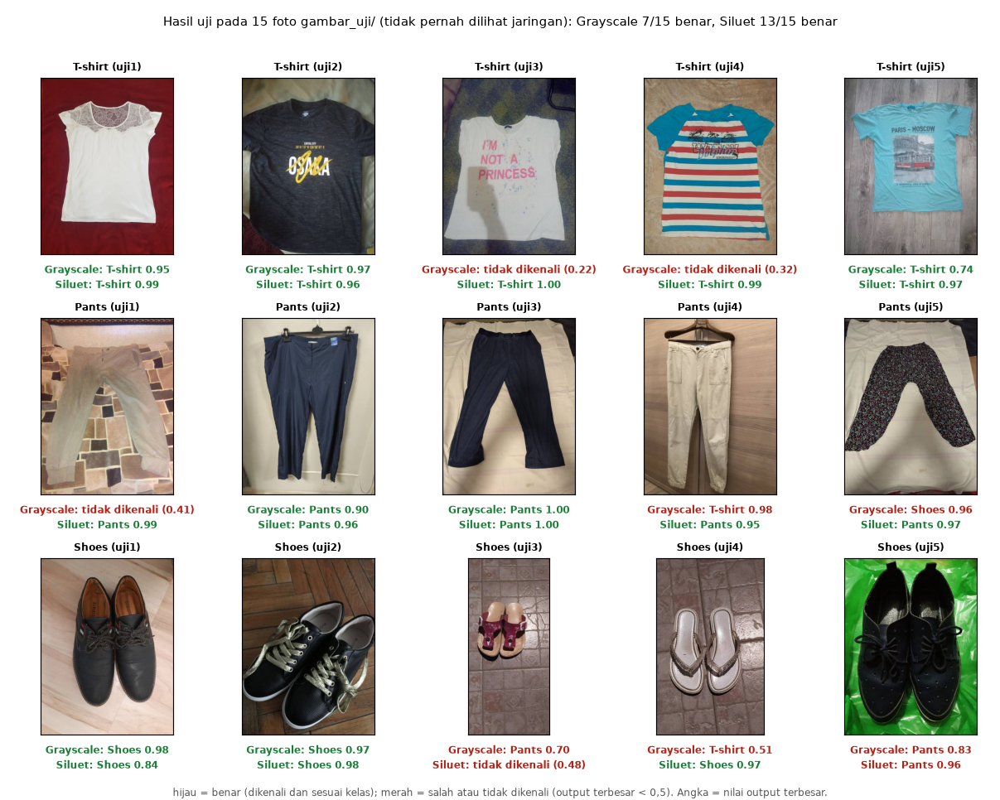
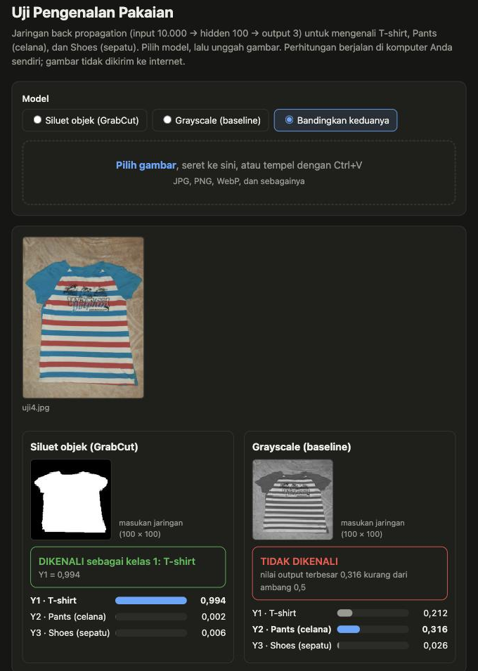

# Jaringan Saraf Tiruan Back Propagation: Pengenalan 3 Jenis Pakaian

Tugas Algoritma Kecerdasan Buatan. Jaringan multilayer (1 hidden layer) dilatih dengan algoritma *standard backpropagation* (Fausett, *Fundamentals of Neural Networks*, Bab 6, hlm. 294-296) untuk mengenali tiga kelas dari foto:

| Kelas | Target (Y1 Y2 Y3) |
|---|---|
| 1. T-shirt | 1 0 0 |
| 2. Pants (celana) | 0 1 0 |
| 3. Shoes (sepatu) | 0 0 1 |

Arsitektur: **10.000 node input (gambar 100 x 100) -> 100 node hidden -> 3 node output**, aktivasi sigmoid biner. Algoritma ditulis manual per langkah dengan NumPy; nama variabel mengikuti notasi buku (`v`, `v_0`, `w`, `w_0`, `z_in`, `z`, `y_in`, `y`, `delta_k`, `delta_in_j`, `delta_j`, `alpha`, `f`, `f_aksen`).

## Dua pendekatan

Proyek ini memuat dua cara menyiapkan gambar (*preprocessing*). Jaringan, parameter, dan data latih sama; yang berbeda hanya isi masukan jaringan.

| | `with_grayscale/` | `with_silhouette/` |
|---|---|---|
| Preprocessing | grayscale -> ubah ukuran 100 x 100 -> bagi 255 | pisahkan objek dari latar (GrabCut, OpenCV) -> siluet putih/hitam -> ubah ukuran 100 x 100 -> bagi 255 |
| Yang dilihat jaringan | intensitas piksel (termasuk latar dan tekstur kain) | bentuk objek saja |
| Perlu OpenCV | tidak | ya |
| Berhenti | epoch ke-474, galat 0,0498 (< 0,05) | epoch ke-100 (batas epoch), galat 1,11 |
| Akurasi latih | 100% | 99,3% |
| Akurasi 45 foto uji (`img51`-`img65`) | 77,8% | 80,0% |
| **Akurasi 201 foto yang tidak pernah dilatih** | **68,2%** (137 benar) | **79,6%** (160 benar) |
| per kelas (T-shirt / Pants / Shoes) | 64/96, 48/64, 25/41 | 84/96, 56/64, 20/41 |
| 15 foto `gambar_uji/` | 7 benar | 13 benar |

Ke-201 foto adalah 45 foto uji, 15 foto `gambar_uji/`, dan 141 foto lain dari bagian validasi dataset sumber. Dengan jumlah segitu, galat bakunya sekitar ±3 poin, jadi selisih sekitar 11 poin antar pendekatan bukan kebetulan.

**Kelebihan dan kelemahan:**
- `with_silhouette` jauh lebih baik pada T-shirt dan Pants, tetapi **lebih lemah pada Shoes** (49% dibanding 61%): siluet sepatu sering berupa gumpalan (sepasang sepatu memenuhi bingkai) atau terlalu kecil (sandal).
- Siluet hanya membawa bentuk. Kelas yang bentuknya mirip (misalnya kaus dan baju lengan panjang) tidak akan bisa dibedakan.
- GrabCut mengasumsikan satu objek utama di dalam bingkai dengan latar yang tidak terlalu ramai. Foto orang yang memakai pakaian atau latar yang sangat ramai kemungkinan besar gagal.
- **Ketentuan "diubah ke grayscale":** siluet disimpan sebagai citra 8-bit satu kanal (bernilai 0 atau 255), tetapi memakai warna untuk memisahkan objek. Pendekatan ini sebaiknya dikonfirmasi ke dosen; `with_grayscale/` adalah versi yang paling sesuai dengan ketentuan.

Pada `with_silhouette`, galat tidak turun di bawah 1 karena satu foto latih (`dataset/kelas2_pants/img27.jpg`, celana tergeletak diagonal di atas karpet bermotif) siluetnya tidak mirip celana lain. Akurasi uji sudah stabil sejak sekitar epoch ke-25, sehingga pelatihan dibatasi 100 epoch.

## Contoh hasil uji

Hasil kedua pendekatan pada 15 foto `gambar_uji/` yang tidak pernah dilihat jaringan (hijau = benar, merah = salah atau tidak dikenali karena output terbesar di bawah 0,5):



Angka di bawah tiap foto adalah nilai output terbesar (Y). Pendekatan grayscale benar pada 7 dari 15 foto, pendekatan siluet pada 13 dari 15. Dua foto yang masih salah pada siluet keduanya sepatu: `uji3` (sandal kecil, dinyatakan tidak dikenali dengan output terbesar 0,48) dan `uji5` (sepasang sepatu memenuhi bingkai, siluetnya berupa gumpalan besar, dan dikenali sebagai Pants dengan Y2 = 0,96).

Tampilan halaman uji web (`uji_server.py`) dengan pilihan **Bandingkan keduanya** pada foto `uji4` (T-shirt): model siluet mengenalinya (Y1 = 0,994), sedangkan model grayscale menyatakan tidak dikenali (output terbesar 0,316).



## Struktur folder

```
Backpropagation/
├── README.md
├── requirements.txt
├── dataset/                 # 3 kelas x 65 foto (img01-img50 latih, img51-img65 uji) + sumber_gambar.csv
│   ├── kelas1_tshirt/
│   ├── kelas2_pants/
│   └── kelas3_shoes/
├── dataset.zip              # isi dataset/ yang sama, untuk diunggah ke Google Colab
├── gambar_uji/              # 5 foto per kelas yang tidak pernah dilihat jaringan + sumber_gambar.csv
├── gambar/                  # gambar hasil uji yang ditampilkan di README
├── uji_server.py            # server uji lokal (halaman web, pilihan model)
├── uji.html                 # halaman web yang dilayani oleh uji_server.py
├── with_grayscale/
│   ├── training.ipynb       # program training (hasil: bobot.npz)
│   ├── pengujian.ipynb      # program pengujian (upload 1 gambar)
│   ├── bobot.npz            # V, v_0, W, w_0
│   └── uji_mandiri.html     # halaman uji satu file, bobot tersemat (tanpa server, hanya model grayscale)
└── with_silhouette/
    ├── training.ipynb
    ├── pengujian.ipynb
    └── bobot.npz
```

Setiap pendekatan memenuhi ketentuan dosen: program training dalam 1 berkas (hasilnya bobot V dan W dalam 1 berkas `bobot.npz`) dan program pengujian dalam 1 berkas (upload 1 gambar, baca bobot, propagasi maju, tampilkan dikenali atau tidak).

## Cara menjalankan

### 1. Persiapan (sekali saja)

Dari folder ini:

```bash
uv pip install --python .venv/bin/python -r requirements.txt
```

(`.venv` dibuat dengan `uv`, jadi gunakan `uv pip`, bukan `pip`.) Untuk `with_silhouette` dibutuhkan `opencv-python`, yang sudah ada di `requirements.txt`. Pastikan kernel notebook yang dipilih memakai `.venv` ini.

### 2. Training (notebook)

Buka `with_grayscale/training.ipynb` atau `with_silhouette/training.ipynb`, jalankan semua sel dari atas ke bawah. Notebook membaca `dataset/` (di folder yang sama atau satu tingkat di atasnya), mencetak galat tiap epoch, dan menyimpan `bobot.npz` di folder notebook itu. Lama pelatihan: beberapa menit.

### 3. Pengujian (notebook)

Buka `pengujian.ipynb` di folder pendekatan yang sama. Jalankan sel "Unggah / pilih 1 gambar": muncul jendela pilih file untuk memilih gambar dari laptop (atau isi `BERKAS_GAMBAR` dengan path gambar). Hasilnya: nilai Y1, Y2, Y3 dan "DIKENALI" atau "TIDAK DIKENALI" (ambang: output terbesar < 0,5). Gunakan gambar yang tidak ikut dilatih: `gambar_uji/` atau `dataset/<kelas>/img51.jpg` sampai `img65.jpg`.

### 4. Uji lewat browser (memilih model)

```bash
.venv/bin/python uji_server.py
```

Buka alamat yang tercetak (biasanya `http://127.0.0.1:8765`). Pilih **Siluet (GrabCut)**, **Grayscale (baseline)**, atau **Bandingkan keduanya**, lalu pilih, seret, atau tempel (Ctrl+V) sebuah gambar. Server hanya dapat diakses dari komputer sendiri, dan gambar hanya diproses di memori. Hentikan dengan Ctrl+C. Opsi: `--port 9000`, `--tanpa-browser`.

### 5. Google Colab

Unggah notebook, jalankan sel dari atas; saat diminta, unggah `dataset.zip`. Di pengujian, unggah `bobot.npz` lalu 1 gambar. (Belum diuji langsung di Colab.)

## Algoritma (Fausett hlm. 294-296)

```
Langkah 0  : inisialisasi bobot (W dan w_0 acak ±0,5; V dan v_0 dengan Nguyen-Widrow, hlm. 297-298)
Langkah 1-2: ulangi untuk setiap epoch; untuk setiap pasangan (x, t)
Langkah 3-5: umpan maju   z_in_j = v_0j + sum x_i v_ij ; z_j = f(z_in_j)
                          y_in_k = w_0k + sum z_j w_jk ; y_k = f(y_in_k)
Langkah 6  : delta_k = (t_k - y_k) f'(y_in_k) ; delta_w_jk = alpha delta_k z_j ; delta_w_0k = alpha delta_k
Langkah 7  : delta_in_j = sum delta_k w_jk ; delta_j = delta_in_j f'(z_in_j) ; delta_v_ij = alpha delta_j x_i
Langkah 8  : perbarui semua bobot dan bias
Langkah 9  : berhenti bila total squared error < 0,05 atau epoch maksimum tercapai
f(x) = 1/(1+e^-x) ; f'(x) = f(x)(1 - f(x))
```

Parameter: `n` = 10.000, `p` = 100, `m` = 3, `alpha` = 0,05 (0,1 tidak stabil dengan 150 pola latih), galat berhenti 0,05, epoch maksimum 1000 (`with_grayscale`) atau 100 (`with_silhouette`). Urutan pola diacak pada tiap epoch (pembaruan per pola). Total bobot: 1.000.403 (hampir semuanya di V), dilatih dengan hanya 150 foto, sehingga overfitting adalah keterbatasan utama (akurasi latih sekitar 100%, akurasi pada foto baru 68% sampai 80%).

## Dataset dan sumbernya

Foto berasal dari **clothing-dataset-small** (Alexey Grigorev), bukan dikumpulkan sendiri.

- Repositori: https://github.com/alexeygrigorev/clothing-dataset-small
- Lisensi: Creative Commons Zero v1.0 (CC0 1.0).
- Dipakai: foto berwarna JPEG (sekitar 400 x 533 piksel) dari tiga kelas, `t-shirt`, `pants`, `shoes`. Tiap kelas di `dataset/` berisi 65 foto: 50 acak dari folder `train` (25 dengan `random.seed(2026)` dan 25 tambahan dengan `random.seed(2027)`) untuk melatih, dan 15 dari folder `test` untuk menguji. Foto tidak diubah.
- `gambar_uji/`: 5 foto per kelas dari folder `validation` (`random.seed(2028)`), tidak termasuk di `dataset/`.
- Pemetaan nama berkas ke berkas asli ada di `dataset/sumber_gambar.csv` dan `gambar_uji/sumber_gambar.csv`.
- Ukuran foto asli tidak seragam; keseragaman 100 x 100 dilakukan oleh program pada tahap preprocessing.

## Pemecahan masalah

| Masalah | Penyebab dan solusi |
|---|---|
| `No module named 'cv2'` | OpenCV belum terpasang di `.venv`: `uv pip install --python .venv/bin/python opencv-python`, lalu restart kernel. |
| `No module named pip` | `.venv` dibuat dengan `uv`; pakai `uv pip install --python .venv/bin/python <paket>`. |
| Jendela pilih file tidak muncul | Isi `BERKAS_GAMBAR` dengan path gambar; atau ketik path saat diminta. |
| Halaman web: "Tidak dapat menghubungi server" | Halaman harus dibuka lewat `uji_server.py` (bukan double-click `uji.html`). |
| Server: "Tidak ada file bobot.npz" | Jalankan training dulu di `with_grayscale/` dan/atau `with_silhouette/`. |
| Peringatan "objek hampir tidak terdeteksi" | Gunakan foto dengan satu objek utama di dalam bingkai (khusus model siluet). |

## Referensi

- Fausett, L. (1994). *Fundamentals of Neural Networks: Architectures, Algorithms, and Applications.* Prentice Hall. Bab 6, hlm. 289-300.
- Grigorev, A. *clothing-dataset-small* (CC0 1.0). https://github.com/alexeygrigorev/clothing-dataset-small
